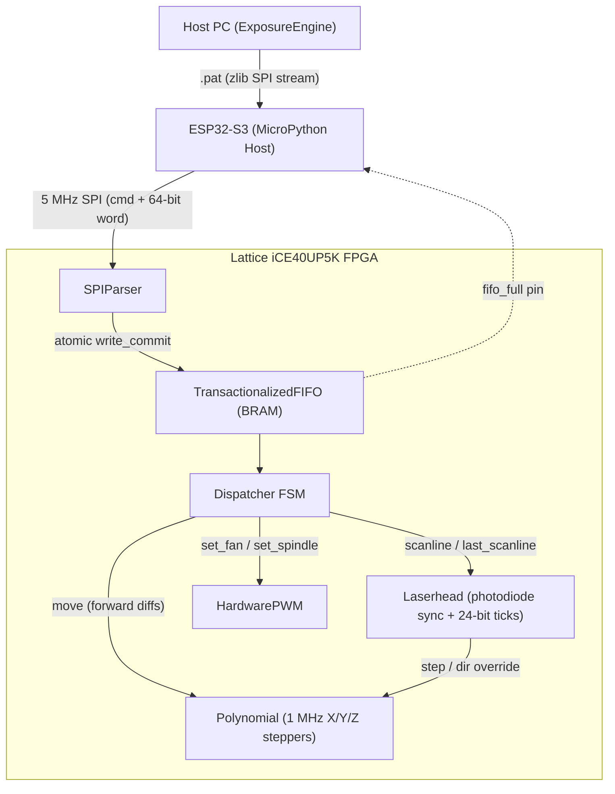

# Hexastorm: Open Source Polygon Laser Scanner

**Hexastorm** is an open-source toolkit for building high-speed, high-resolution polygon [laser scanners](https://en.wikipedia.org/wiki/Laser_scanning). Designed for **PCB Laser Direct Imaging (LDI)** and **SLA 3D printing**, it combines optical/geometric pattern generation on a PC, an **ESP32-S3** host controller (MicroPython), and a **Lattice iCE40UP5K FPGA** (**Amaranth HDL**) for deterministic sub-microsecond laser and stepper timing.

Unlike galvanometer scanners, Hexastorm sweeps the laser beam across the substrate using a continuously rotating 4-facet prism and locks every scanline to an optical photodiode trigger.


### Project Resources
* **Website:** [Hexastorm.com](https://www.hexastorm.com)
* **Blog & Updates:** [Hackaday.io Project Page](https://hackaday.io/project/21933-open-hardware-fast-high-resolution-laser)
* **Hardware & Firmware:**
  * **Mechanical (FreeCAD):** [hstarmans/hexastorm_design](https://github.com/hstarmans/hexastorm_design)
  * **Electronics (PCB):** [hstarmans/firestarter](https://github.com/hstarmans/firestarter)
  * **ESP32-S3 Firmware:** [hstarmans/esp32_hexastorm](https://github.com/hstarmans/esp32_hexastorm)

*Acknowledgement: This codebase draws inspiration from [LDGraphy](https://github.com/hzeller/ldgraphy).*

### Demos
**Making a PCB with Laser Direct Imaging**

[](http://www.youtube.com/watch?v=dR09Tev0cPk "Making PCB with Laser Direct Imaging")

---

## How It Works



### 1. Pattern Generation & Optics (`src/hexastorm/exposure/`)
`ExposureEngine` (`engine.py`) converts designs into `.pat` files containing pre-framed, `zlib`-compressed SPI packets:
* **Vector inputs (`.svg`, e.g. KiCad):** `VectorExposure` (`vector.py`, with an optional C extension in `csrc/`) flattens SVG shapes into closed polygons, transforms coordinates through `Design → Machine → Laserhead` (`LaserheadMount` / `CoordinateTransform` in `coordinates.py`), intersects scanlines directly with the polygon edges, and maps hit positions `u_hit` through the non-linear Snell's-law prism curve (`PrismCurve`) into **24-bit FPGA clock ticks**.
* **True bitmaps & vector-to-raster fallback (`raster.py`, `geometry.py`):**
  * True bitmaps (`.png`, `.jpg`, `.bmp`, `.tif`, ...) keep their native pixel dimensions (resolved from `pixelsize` or embedded DPI metadata without re-discretizing onto `samplegridsize`) and traverse scanlines directly across native pixel boundaries onto `24 MHz` clock ticks via `RasterExposure.slice_bitmap()` and `PrismCurve` (binary default; opt-in `grayscale=True`).
  * `samplegridsize` (`0.01 mm` / `10 µm` → `560` samples/line) acts strictly as the **vector-to-raster fallback DPI** (for `.ps`/`.eps` and `.svg` in `mode="raster"` or `grayscale=True`) and PC debug-plot resolution (`plotter.py` / `readbin()`).
* **Event-driven encoding (`ulabext.py`, `io.py`):** Rather than streaming raw pixel bitmaps, each scanline stores only state-change events (`[8-bit intensity | 24-bit tick]`, packed 2 events per 64-bit word). Blank scanlines cost just 1 header word.

### 2. Host-to-FPGA Protocol (SPI + Transactionalized FIFO)
The ESP32-S3 (`src/hexastorm/fpga_host/`) streams 9-byte SPI frames (`1 command byte + 64-bit word`) to `SPIParser` (`src/hexastorm/core.py`):
* **SPI commands (`Spi.Commands`):** `write` (push word into FIFO), `read` (status flags + limit switches / photodiode / sync state), `debug` (last measured facet period + facet ID), `flush` (clear FIFO and parser error/word counters), `start`, and `stop`.
* **FIFO instructions (`Spi.Instructions`):** `move`, `write_pin`, `scanline`, `last_scanline`, `set_fan`, and `set_spindle`.
* **Atomic commits & flow control:** Multi-word instructions (`move` and variable-length `scanline`) are buffered in `TransactionalizedFIFO` (`src/hexastorm/luna/memory.py`) and only become visible to `Dispatcher` on `write_commit`, so an interrupted transfer never executes half an instruction. The FPGA asserts the hardware `fifo_full` pin whenever remaining BRAM capacity drops to `≤ fifo_margin_words`.

### 3. Laser Timing & Motion Control (`src/hexastorm/`)
* **Laser timing (`lasers.py`, `blocks/photodiode_debounce.py`):** At 3000 RPM on a 4-facet prism and a 24 MHz FPGA clock (`hfosc_div = 1`), one facet sweeps every `120 000` clock ticks. After spin-up, `Laserhead` enables one diode channel at the end of each sweep to detect the active-low photodiode (`pd_debounce_us = 20.0` µs, 2FF-synchronized and debounced). Once consecutive triggers fall within the `±1%` jitter window (`synchronized = 1`), each active scanline waits until `start_frac` (`0.35`), counts `line_tick` from `0` through `scanline_ticks` (`42 000` ticks at `41.7 ns` resolution), drives both laser channels via 1st-order `24 MHz` Sigma-Delta PDM (`0` = off, `255` = constant 100% binary ON, `1..254` = PDM grayscale for fast drivers like iC-HKB), and steps the orthogonal stage axis directly at the `24 MHz` clock using `step_half_period` (`0` = stationary). Any trailing unread event words are drained before advancing to the next scanline.
* **Stage motion (`movement.py`):** Between exposure lanes or for homing/positioning, `Polynomial` runs at `1 MHz` and evaluates host-precomputed discrete forward differences (`D1`, `D2`[, `D3`]) up to `10 000` ticks per segment using fixed-point Q-format accumulators (`bit_shift = 25`), preserving sub-step fractions across segments without hardware DSPs. During active scanlines, `Laserhead` seamlessly overrides `step`/`dir` on the orthogonal axis (`orth2lsrline`).
* **iCE40UP5K footprint:** Synthesizes to ~50% LCs (`2659 / 5280`), 93% BRAM (`28 / 30`), with `Fmax ≈ 28.7 MHz` at a `24.00 MHz` clock target.

### 4. Stability Testing & Optical Calibration (`fpga_host/`, `calibration/`)
* **Laserhead statistical stability (`ESP32Host.test_laserhead`):** On every valid synchronized photodiode trigger, `Laserhead` latches `facet_period_ticks = [ticks_per_facet | facet_id]`, which the host polls via `Spi.Commands.debug` (`N = 200` target samples/facet with randomized jittered intervals to avoid aliasing with prism rotation). A two-stage statistical test verifies (1) global mean period against the theoretical `5.0 ms` (`3000 RPM`, `4` facets; fails above `±10%`), and (2) per-facet 3-sigma jitter and Process Capability `Cpk = jitter_exp_perc / (3 × std_dev_perc)` against the `0.2%` exposure jitter limit (`Cpk ≥ 1.0` required per facet → 99.73% of spots within spec). `PlatformConfig.compute_photodiode_scan_corrections()` also supports zero-camera feed-forward along-scan correction (`k_scale = 1.628 mm/ms`) directly from measured facet period deviations.
* **Closed-loop dot-pattern calibration & `LaserStackSimulator` (`analyzer.py`, `stack.py`, `tests/camera/test_optical.py`):**
  1. *Visibility scan (`scan_visibility`):* sweeps a single lit position across the `10 µm` software scanline grid (`bitsinscanline = 560`) to map which coordinates fall inside the stationary camera sensor (`scan_visibility.json`).
  2. *1D dot-pattern calibration (`baseline_calibration_cycle`):* flashes a raw repeating dot line per facet across `10` iterations, extracts dot centroids and ellipses (Otsu + `cv.fitEllipse`), removes camera tilt, compares each facet against a spatial-median **Virtual Reference Facet**, and stores per-facet `(scan, orth)` offsets and statistics in `calibration_history.json`.
  3. *Corrected exposure (`get_optical_params(correction=True)`):* feeds the measured per-facet `(scan, orth)` offsets into `ExposureEngine` / `CameraCalibrationGen` so each facet's timing and orthogonal stage position pre-compensate mechanical prism differences.
  4. *Closed-loop 2D verification (`LaserStackSimulator`, `pattern_error`):* generates a 2D dot grid before and after correction, streams the raw `24 MHz` scanline events (`readbin_events` / `write_events`) onto the stationary camera without pixel re-quantization, and uses `LaserStackSimulator` to rotate and orthogonally shift each row (`num_steps × step_px`) to reconstruct the full 2D image as if the stage had moved — verifying that residual facet-to-facet 2D error drops within `≤ 30 µm`.

---

## Repository Map

| Path | Purpose |
| :--- | :--- |
| [src/hexastorm/core.py](src/hexastorm/core.py) | `SPIParser` and `Dispatcher` top-level gateware FSMs |
| [src/hexastorm/lasers.py](src/hexastorm/lasers.py) | `Laserhead` photodiode sync + event-driven timing & `DiodeSimulator` |
| [src/hexastorm/movement.py](src/hexastorm/movement.py) | `Polynomial` 1 MHz forward-difference stepper generator |
| [src/hexastorm/pwm.py](src/hexastorm/pwm.py) | `HardwarePWM` for cooling fan and prism spindle |
| [src/hexastorm/blocks/](src/hexastorm/blocks/) | Reusable gateware blocks (`PhotodiodeDebounce`) |
| [src/hexastorm/luna/](src/hexastorm/luna/) | Self-contained LUNA-derived `TransactionalizedFIFO` & `SPICommandInterface` |
| [src/hexastorm/platforms.py](src/hexastorm/platforms.py) | `Firestarter` (`LatticeICE40Platform`) pinout, YoWASP build & `mpremote` flasher |
| [src/hexastorm/config.py](src/hexastorm/config.py) | Shared SPI protocol constants, optical parameters & FPGA/ESP32 config |
| [src/hexastorm/fpga_host/](src/hexastorm/fpga_host/) | `BaseHost`, `ESP32Host`, and `MockHost` (PC + MicroPython compatible) |
| [src/hexastorm/exposure/](src/hexastorm/exposure/) | `ExposureEngine`, `VectorExposure`, `RasterExposure`, `plotter`, patterns |
| [src/hexastorm/calibration/](src/hexastorm/calibration/) | Optical dot-pattern analysis, facet calibration & `LaserStackSimulator` |
| [tests/](./tests/) | Amaranth gateware simulations (`tests/fpga/`), exposure, calibration & tool tests |
| [developer.md](./developer.md) | Wire-level SPI/FIFO bit layouts, calibration workflow & camera setup (ESP32-S3 OV2640 + legacy RPi OV2311) |

---

## Install & Usage

1. Install [uv](https://github.com/astral-sh/uv):
   ```console
   curl -LsSf https://astral.sh/uv/install.sh | sh
   ```
2. Sync dependencies from [pyproject.toml](./pyproject.toml):
   ```console
   uv sync
   ```
3. Build and deploy the FPGA bitstream to a connected ESP32-S3 + iCE40UP5K board (or pass `--no-program` to synthesize locally only):
   ```console
   uv run build
   uv run build --no-program
   ```
4. Run tests and linter:
   ```console
   uv run pytest
   uv run pytest -vv tests/fpga/test_core.py
   uv run ruff check src tests
   ```
5. Generate patterns and `.pat` exposure files:
   ```console
   uv run pat_machine
   uv run exposure
   ```

Optical calibration workflows, camera setups (onboard ESP32-S3 OV2640 and legacy Raspberry Pi OV2311), and wire-level SPI/FIFO instruction formats are documented in [developer.md](./developer.md).
